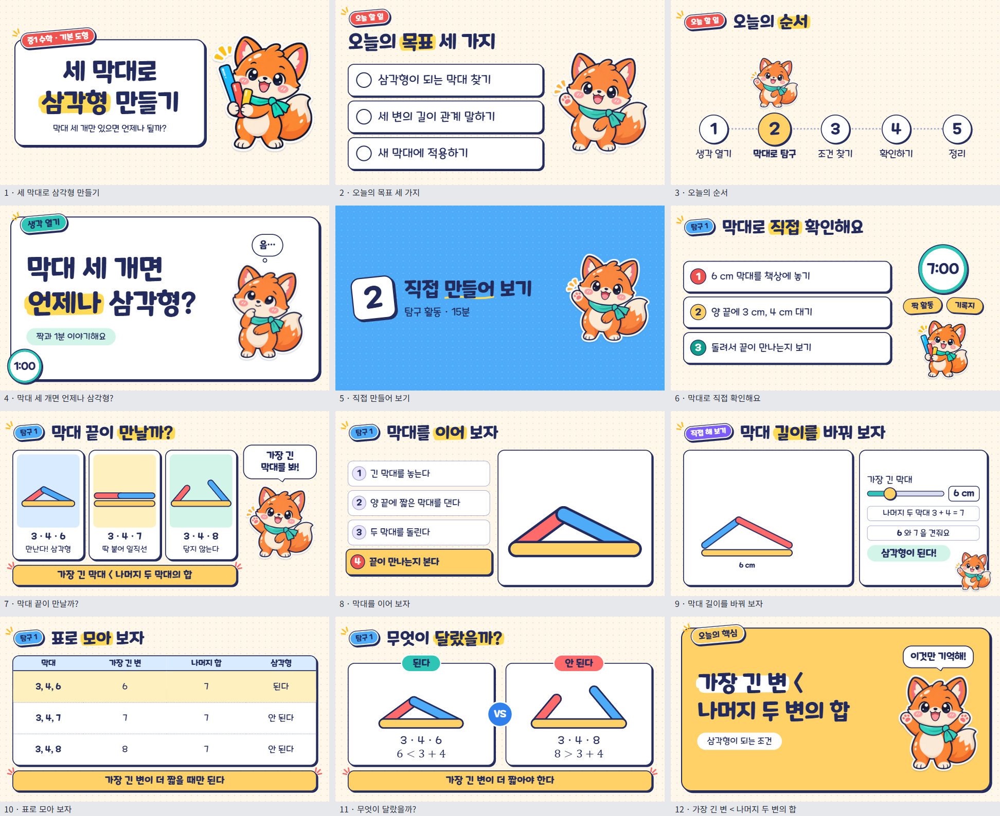
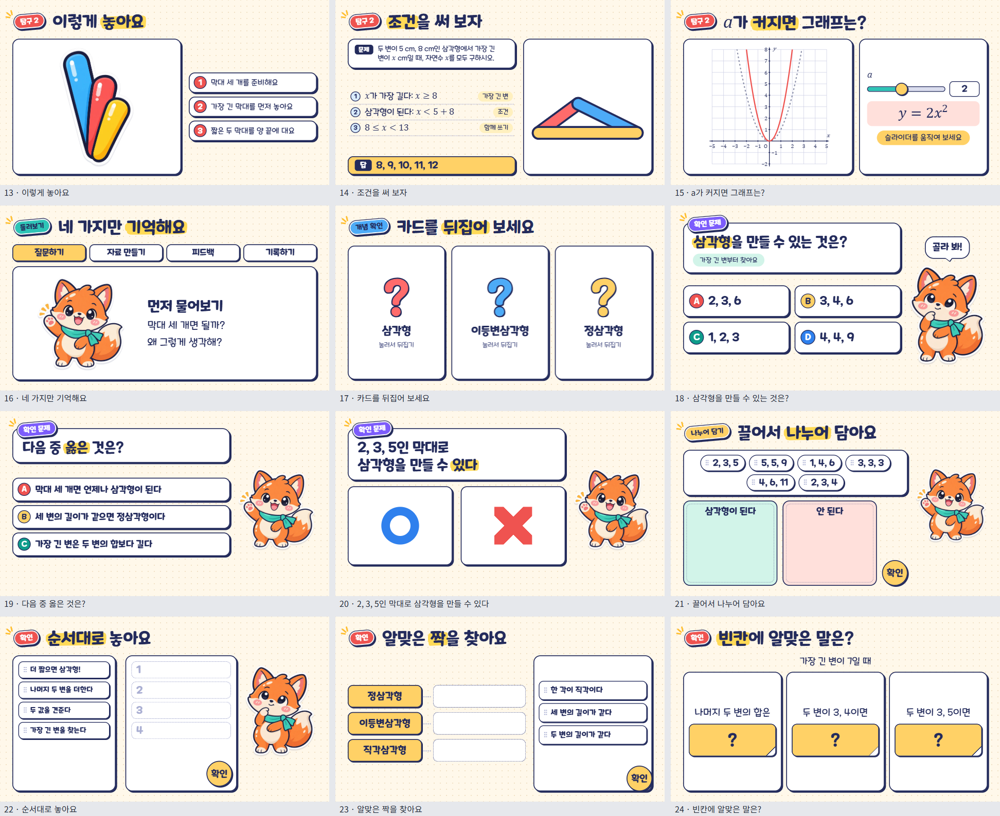

# pbj-html-deck

PPT 대신 쓰는 **HTML 수업 슬라이드 한 파일**을 만드는 에이전트 스킬입니다. Codex(또는 Claude Code)에 주제를 말하면 구상부터 그림 생성, 구현, 검사까지 스킬이 정한 순서대로 진행합니다.




## 만들어지는 것

- 1920×1080 캔버스의 HTML 파일 하나. 인터넷 없이 열립니다.
- 이미지 모델로 만든 마스코트와 스티커, 메이플스토리 글꼴.
- 수업 중에 직접 조작하는 상호작용: 고르기, O/X, 끌어 놓기(나눠 담기·순서·짝), 답 쓰기, 눌러서 여는 카드와 빈칸, 탭, 타이머, 번호 뽑기, 슬라이더로 움직이는 그림과 그래프, 판서.
- 브라우저에서 글자를 고치고 요소를 옮겨 같은 파일에 저장할 수 있습니다.

| 키 | 하는 일 |
| --- | --- |
| `←` `→` | 넘기기 |
| `F` | 발표(전체 화면) |
| `P` | 판서 펜 |
| `G` | 모아보기 |
| `E` | 편집 모드 |
| `Ctrl+S` | 저장 |

## 설치

Codex나 Claude Code에 아래 한 줄을 붙여 넣습니다.

```text
https://github.com/BeomjinSouth/pbj-html-deck 저장소를 받아서 pbj-html-deck이라는 이름의 전역 스킬로 설치해 줘. Codex면 ~/.codex/skills, Claude Code면 ~/.claude/skills 아래에 넣어 줘.
```

인터넷에서 내려받고 작업 폴더 밖에 쓰는 일이라 허용 여부를 묻는 창이 뜹니다. 허용한 뒤 Codex나 Claude Code를 새로 열면 스킬이 잡힙니다.

직접 넣으려면 이 폴더 전체를 스킬 폴더에 `pbj-html-deck`이라는 이름으로 넣습니다.

- Codex: `~/.codex/skills/pbj-html-deck`
- Claude Code: `~/.claude/skills/pbj-html-deck`

필요한 것:

- Python 3.9 이상(Pillow가 있으면 그림을 줄여 넣습니다)
- Chrome 또는 Edge(화면 검사와 시안 캡처에 씁니다)
- 그림 생성에는 Codex CLI의 이미지 도구를 씁니다. 쓸 수 없는 환경에서는 가진 그림을 넣는 방법이 [시안과 에셋](references/시안과-에셋.md) 5절에 있습니다.
- 스킬 자체의 시험(`tests/engine`)을 돌릴 때만 Node가 필요합니다.

## 쓰는 법

HTML 슬라이드로 만들어 달라고 분명히 말합니다.

```text
pbj-html-deck 스킬로 중1 수학 정비례 그래프 수업 HTML 슬라이드 10장 만들어 줘.
```

스킬이 밟는 순서는 구상(콘티) → 뼈대 → 시안 → 에셋 → 구현 → 검사 → 대조 → 마감입니다. 자세한 내용은 [SKILL.md](SKILL.md)에 있습니다.

## 내 것으로 고치기

마스코트, 색, 수업 흐름을 내 수업에 맞게 바꾸려면 스킬 폴더의 사본을 만들고 이렇게 요청합니다.

```text
받은 수업 스킬은 원본 대신 지금 폴더의 사본만 고쳐 줘. 내 수업의 주인공은 민트색 목도리를 두른 고슴도치로 그림 만들기를 써서 만들고, 남색과 민트색을 주로 써 줘. 첫 장은 예상 질문, 활동 장은 먼저 고르고 이유를 말한 뒤 정답을 여는 순서로 해 줘. 이렇게 바꾼 규칙과 그림을 다음 수업에도 쓰도록 스킬 안에 남겨 줘.
```

## 알아둘 점

- 에이전트가 직접 그린 도형과 그래프에는 수학 오류가 섞일 수 있습니다. 조작하는 그림의 길이와 좌표는 수업 전에 직접 검산하세요.
- 화면 검사는 Chrome에서만 확인했습니다. 실제 터치 화면, 판서 펜, 다른 브라우저는 확인하지 못했습니다.
- 결론 띠의 세로 가운데 정렬은 Chrome 123, Safari 17.4, Firefox 125 이상에서 동작합니다.
- 디자인 점검 도구 임페커블(impeccable)이 `~/.impeccable/bin/`에 설치돼 있으면 `check`와 `compare`가 함께 씁니다. 없어도 동작합니다.

## 폴더 구성

| 폴더 | 내용 |
| --- | --- |
| `SKILL.md`, `references/` | 에이전트가 읽는 작업 순서와 규칙 |
| `scripts/` | 콘티 검사, 뼈대 만들기, 묶기, 화면 검사, 그림 생성, 시안 대조 도구 |
| `assets/engine/` | 넘기기·편집·상호작용·판서·검사 엔진 |
| `assets/kit/` | 화면 부품(CSS, 구도 틀 29종, 색 묶음 4종) |
| `assets/fonts/` | 메이플스토리 글꼴과 저작권 안내 |
| `examples/부품-견본/` | 모든 구도를 한 번씩 쓴 29장 견본 콘티 |
| `tests/` | 도구·엔진·부품 시험 |

## 라이선스

글꼴을 뺀 나머지(스킬 문서, 도구, 엔진, 부품, 견본)는 [MIT 라이선스](LICENSE)입니다. 저작권 표시와 라이선스 글만 남기면 수업·연수·업무에 자유롭게 쓰고, 고치고, 다시 나눠도 됩니다.

`assets/fonts/`의 글꼴 파일에는 MIT 라이선스가 적용되지 않고 아래 넥슨의 조건을 따릅니다.

## 글꼴

메이플스토리 서체의 지적 재산권을 포함한 모든 권리는 ㈜넥슨코리아에 있습니다. 이 저장소는 글꼴 파일을 고치지 않고 저작권 안내([assets/fonts/NOTICE.txt](assets/fonts/NOTICE.txt))와 함께 그대로 담았습니다. 글꼴 자체를 유료로 판매할 수 없습니다.
